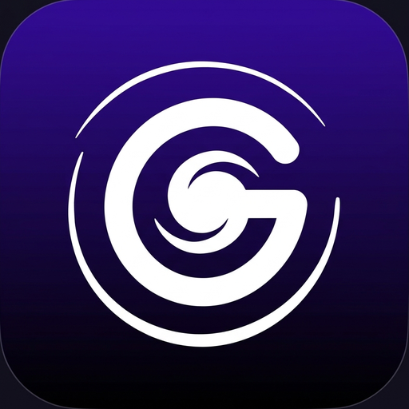
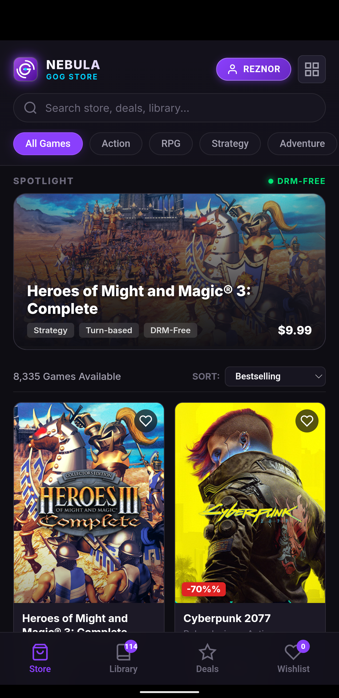
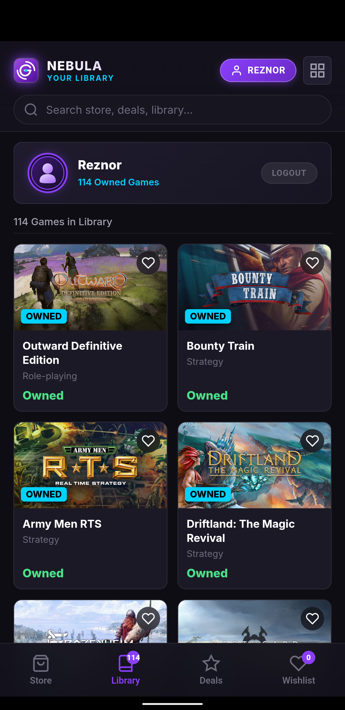
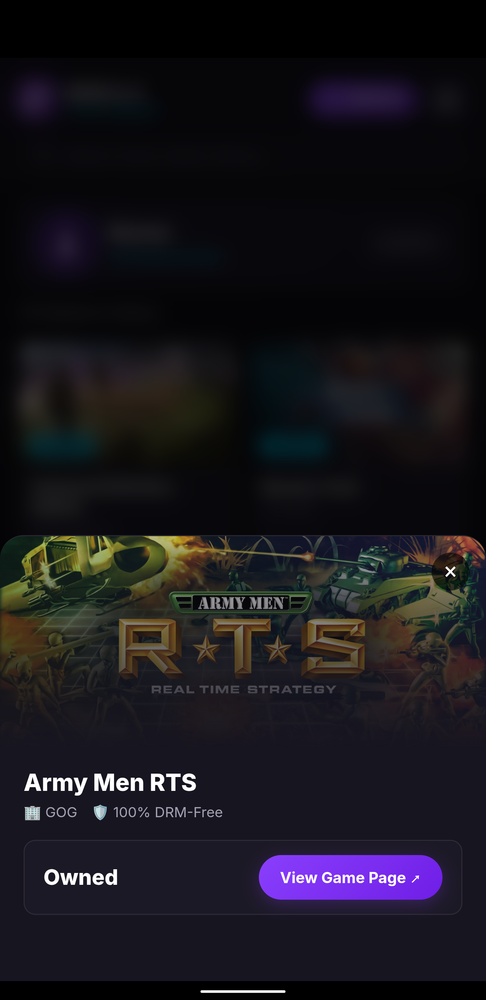

# Nebula — GOG Galaxy Mobile

<p align="center">
  
</p>

<p align="center">
  <b>Ultra-lightweight React Native mobile store and library viewer for GOG Galaxy.</b><br/>
  DRM-free browsing, live account library sync, and instant store checkout.
</p>

<p align="center">
  
  
  
  
</p>

---

## Screenshots

<p align="center">
  
  
  
</p>

---

## Features

- 🎮 **Live GOG Catalog**: Real-time browsing directly via official GOG Catalog API (`https://catalog.gog.com/v1/catalog`), with instant search, genre filters (Action, RPG, Strategy, etc.), and bestselling sorting.
- 📚 **GOG Account Library Sync**: Secure OAuth2 login supporting GOG, Google, Steam, and Xbox login providers. Seamlessly synchronizes your owned games (with full pagination past 100+ titles).
- 🏷️ **Deal Spotlight & Wishlist**: Quickly filter games currently on sale and manage your local wishlist.
- 🛡️ **Zero-Telemetry & 100% DRM-Free**: No trackers, no analytics, no ads.
- 🔒 **Security-First Architecture**: Read-only browsing within the client. Purchases open directly in the official `gog.com` web checkout, keeping financial and payment credentials strictly outside the client.

---

## Getting Started

### Prerequisites

- Node.js (v18+)
- npm or yarn
- Optional: [Expo Go](https://expo.dev/go) app on your Android or iOS device

### Installation

```bash
# Clone repository
git clone https://github.com/OpenWorldProjects/nebula-mobile.git
cd nebula-mobile

# Install dependencies
npm install
```

### Running the App

Run the app using standard React Native / Expo commands:

```bash
# Start the Metro bundler / Expo dev server
npm start
# or
npx expo start
```

Press:
- `a` to run on a connected Android device or emulator
- `i` to run on iOS simulator
- `w` to run on web browser

---

## F-Droid Publication

Nebula is built entirely with open-source technologies and adheres to F-Droid FOSS principles:

1. **Licensing**: Licensed under the GNU General Public License v3.0 or later (GPL-3.0-or-later).
2. **Privacy**: Contains no proprietary trackers, ads, or binary telemetry SDKs.
3. **F-Droid Anti-Features**:
   - `NonFreeNet`: F-Droid applies this standard tag because the app connects to GOG.com's network service to fetch catalog and library data. This is standard for open-source clients of web services (such as NewPipe or Tusky).
4. **Distribution Options**:
   - **Official F-Droid**: Submit metadata recipe to [`fdroiddata`](https://gitlab.com/fdroid/fdroiddata).
   - **Custom F-Droid Repository**: Can be hosted via GitHub Pages using `fdroidserver` for instant over-the-air updates.

---

## License

This project is licensed under the GPL-3.0-or-later License. See `LICENSE` for details.
All GOG game trademarks, artwork, and covers belong to CD PROJEKT and their respective owners.
